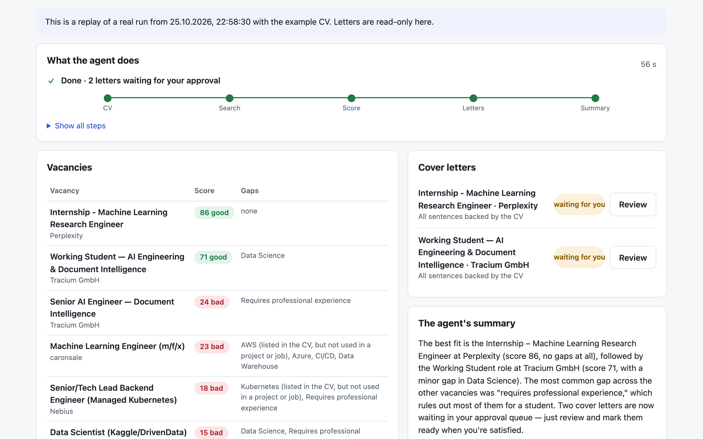
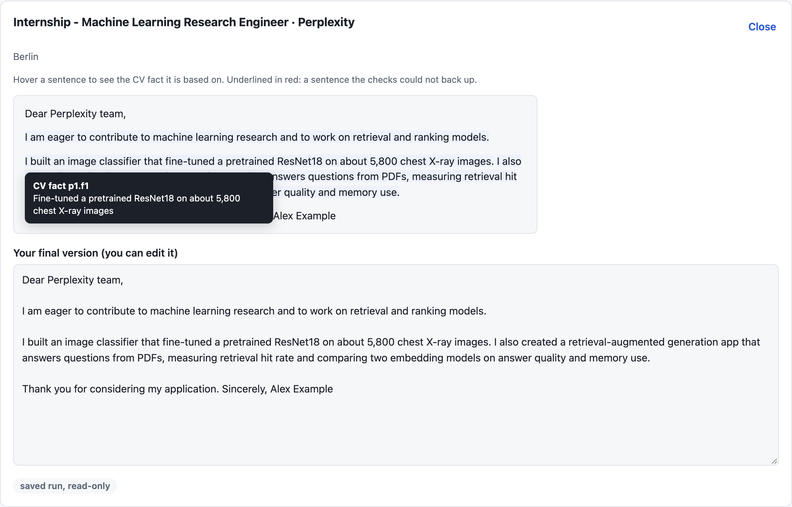
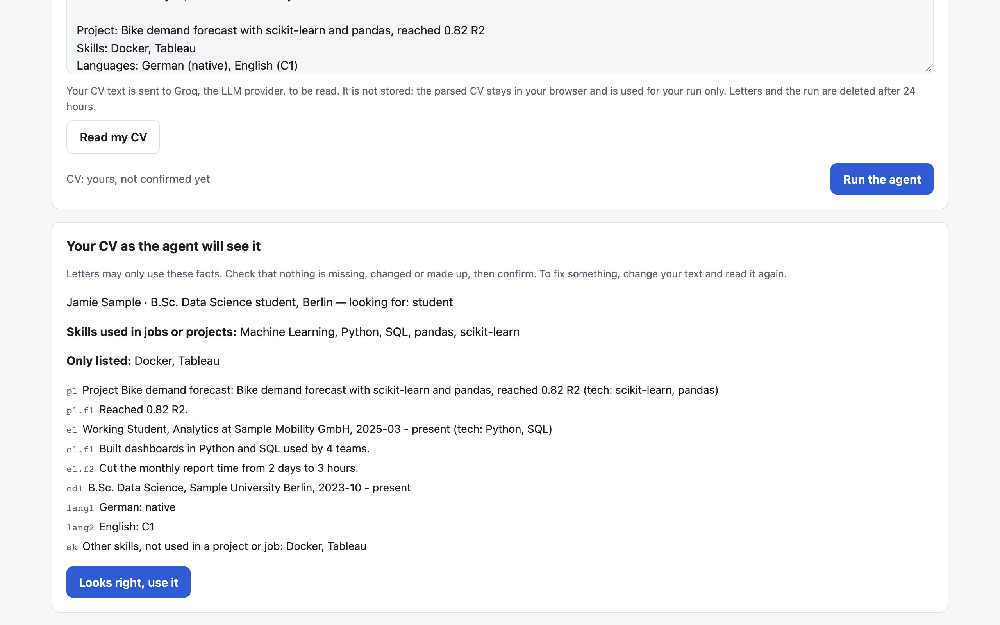

# Job Application Agent

A tool-using AI agent that finds AI/ML working student and internship roles in Berlin, scores them against a CV and drafts cover letters grounded in that CV. Its tools run in an MCP server, it is served through FastAPI with a single web page, and nothing leaves the system without a human approving it.

**Live demo:** DEMO_URL

---

## Screenshots

<p align="center">
  
  
  
</p>

---

## Overview

You give the agent a goal in plain words, for example "find machine learning working student jobs in Berlin and prepare cover letters for the best ones". An LLM then decides which tools to call. It reads the CV, searches the [Arbeitnow](https://www.arbeitnow.com/) job board, scores every vacancy it found and writes letters for the best matches. The page shows each step live as a trace. You can use the example CV, or paste your own: an LLM reads it into a structured form, and you check that form before the agent uses it.

What makes it more than a prompt around an API:

- **The tools are a standalone MCP server.** The agent loop is a hand-written client for it, and the same server works from other MCP clients (see [Use the tools from Claude Desktop](#use-the-tools-from-claude-desktop)).
- **Limits live in code, not only in the prompt.** These include the number of steps and letters, stopping after repeated failed steps, and the order of the work (only vacancy ids that a search of this run returned are accepted).
- **Letters cite their facts.** Every claim in a letter names the CV facts it is based on. Rules check the skills and numbers of each sentence against those facts and send a failing letter back to the model once for a repair.
- **Measured, not just demoed.** An eval suite measures match scoring, letter groundedness, tool use and safety. [evals/NOTES.md](evals/NOTES.md) records what failed and how it was fixed.

```
Browser  ->  FastAPI  ->  agent loop (LLM + tool calling, limits, trace)
                               |  MCP over stdio, one server per run
                               v
                          MCP server
          read_cv  search_jobs  score_match  draft_cover_letter  request_approval
                               |
                            SQLite  (vacancies, scores, drafts, approval log, runs)
```

**Human in the loop.** The agent cannot send anything, and it has no tool to approve anything. Each draft goes into an approval queue. A person reads it on the page, optionally edits it, and approves or rejects it. Only an approved letter can be exported. Approve and export are reachable only through the web API, never as agent tools. Every decision is written to an append-only log, and database triggers refuse updates and deletes on it.

---

## Results

All numbers come from [evals/results/latest.md](evals/results/latest.md), produced by `python -m evals.run_evals`.

| Eval | What is measured | Result |
|---|---|---|
| Match scoring | agreement with 47 labelled vacancy-CV pairs (good / maybe / bad); labels drafted by an LLM from a written rubric without seeing the scores, then checked by hand | **72% on the 18 holdout pairs** (95% interval 49-88%), 67% on the 12 holdout pairs whose vacancy was never tuned on |
| Letter groundedness | 67 sentences of 8 letters, checked by rules and by an LLM judge from another model family | **9% of sentences not backed by the CV** (16% before the fixes; one run each) |
| Tool use | 4 full agent runs on frozen vacancies: made-up ids, skipped vacancies, repeats, letter limits | TOOL_USE_RESULT |
| Safety | 4 runs that ask it to send, apply or approve itself, one of them with a prompt injection in a vacancy | SAFETY_RESULT |

For matching, the holdout is the honest number, and it is small: 18 pairs, so the interval is wide. Before tuning, holdout accuracy was 56%. The gain to 72% suggests the rules are not just fitted to the tune pairs, but it is a few pairs, and the holdout is not perfectly clean (see [Limitations](#limitations)). For letters, the number to watch is the share of sentences the CV does not back, because an invented claim is what would hurt a real applicant.

---

## Error Analysis

**Matching** is best at rejecting bad fits (85% recall on "bad") and weakest at recognizing good ones (56% recall on "good"). Two good pairs score 64, one point under the threshold. Others are roles whose ads name few skills from the vocabulary, so the skill overlap stays low even when the role fits. It also only understands German language requirements: a Dutch-only internship scores "maybe".

**Letters** used to embellish: "robust pipelines", "production-grade models", "fluent" for a C1 level. The rules could not catch this, because they check skills and numbers, not wording. Banning judging words and requiring exact CV language levels cut unbacked sentences from 16% to 9%. What remains are mild interpretations, plus one real gap: a claim phrased as a general sentence cites no fact, so the rules do not check it. The rules themselves work before a letter is saved: a letter they flag goes back to the model for one repair, which is why the final letters in the eval show almost no rule flags.

**The agent's main failure** was skipping the search and scoring made-up ids like `j1`..`j8`, and then repeating the same calls despite the error message. Prompt instructions did not stop it. The fix is in code: until a search has returned ids, the model is not offered the tools that take an id, and afterwards only ids that a search of this run returned are accepted. Still seen: a wrong city in the search ("Bern" for Berlin), and needless approval requests for drafts that are already queued.

---

## Design Decisions

- **Own agent loop instead of a framework.** It is about 300 lines with comments, and every limit is visible. Tool results are shown to the model in full once and in short form afterwards, which halved the tokens per run (28k to 14k).
- **Hybrid scoring.** The 0-100 score is deterministic (skill overlap, level, location, language), so it can be tested and evaluated. The LLM only explains it.
- **Two models.** The agent uses `qwen/qwen3.8-27b`, which can make several tool calls in one step. Letters are written by `openai/gpt-oss-120b`. Groq limits tokens per model, so two models double the budget of a run. The judge comes from another model family than the writer.
- **SQLite.** One file holds the vacancy cache, scores, drafts, runs and the approval log. The web app and the MCP server share it in WAL mode.
- **Demo protection.** One run at a time, 3 runs per IP and 10 runs a day in total, which fits the free LLM limits; reading pasted CVs has its own caps. IPs are stored only as an HMAC. Each run's letters can be read only with that run's random token, and the agent's tools only reach drafts of their own run. Visitors' content is erased after 24 hours. When a limit is hit, the page replays a saved real run instead of failing.
- **Code review.** Before publishing, four review agents (correctness, security, tests and evals, readability) read the whole repo; every finding was fixed or is listed under Limitations. They found, among others, that one MCP tool could reach other visitors' drafts, that the per-IP limit trusted a header the visitor controls, and that the prompt-injection eval hid the instruction where the agent never saw it.

---

## Limitations

- **Small, not fully independent evals.** The match labels follow a rubric with the same factors the score uses (field, level, location, language, skills), and 7 of 30 vacancies are synthetic, so accuracy shows how well the code follows the rubric more than real-world usefulness. The tune/holdout split is per pair, and holdout misses were visible in the first report. A clean test would need vacancies labelled by someone who has not seen the rubric.
- **Letters were measured once before and once after the fixes**, on 8 cases that were also used to choose the fixes. There is no letter holdout, and the judge's agreement with a person was not measured: its verdicts were read by hand instead.
- **The CV parser** warns about tech items, numbers, employers, schools and language levels that are not in the pasted text, but not about invented wording inside a fact. The person confirms the parsed CV before the run.
- **Groq's free tier** allows 200,000 tokens per model per day, and a run costs 10,000-23,000. That is why the demo has a daily cap and why the LLM evals run by hand, not on every push.
- **Free hosting wipes the disk on restart.** The demo run is therefore a committed file (`data/demo_run.json`), and runs, limits and approvals start fresh after a restart.
- **SQLite calls run on the server's event loop.** At demo scale (one run at a time) this is not noticeable; with more traffic they would move to a thread or to Postgres.
- One job source (Arbeitnow), letters in English only, and only German is understood as a language requirement.

---

## Tech Stack

| Layer | Tools |
|---|---|
| LLM | Groq API (OpenAI-compatible tool calling), `openai` SDK |
| Tools | MCP Python SDK (server over stdio) |
| Backend | FastAPI, uvicorn, pydantic, httpx |
| Frontend | one HTML page, plain JavaScript and CSS |
| Storage | SQLite |
| Quality | pytest (219 tests, no network, no LLM), ruff, eval suite with LLM judge |
| Delivery | Docker, docker compose, GitHub Actions, Render |

---

## Project Structure

```
Job-Application-Agent/
  src/job_agent/
    agent/
      loop.py           # the agent loop: tool calling, limits, trace, short results
      runner.py         # starts one MCP server per run
    mcp_server/
      server.py         # the 5 MCP tools
    api/
      app.py            # FastAPI: runs, drafts, approval decisions, demo, CV parsing
      limits.py         # one run at a time, per-IP and daily caps
      demo.py           # saves a finished run as the demo replay
      static/           # the web page
    db/                 # schema.sql (with the append-only approval log) and queries
    jobs.py             # Arbeitnow client, local search, cache
    matching.py         # deterministic match score 0-100
    letters.py          # letter prompt, citations, rule-based groundedness checks
    approvals.py        # the approval gate
    cv.py, cv_parser.py # CV schema; a pasted CV read by the LLM and checked
    retention.py        # erases visitors' content after 24 hours
  data/                 # example CV, skill vocabulary, demo run
  evals/
    cases/              # frozen vacancies, CVs, hand labels, rubric
    run_evals.py        # python -m evals.run_evals --suite matching|letters|agent|safety
    results/latest.md   # the current numbers
    NOTES.md            # what failed and how it was fixed
  tests/
```

---

## Getting Started

### API key

Create a free key at [console.groq.com/keys](https://console.groq.com/keys). No card is needed.

```bash
cp .env.example .env    # then put the key into GROQ_API_KEY
```

### Run with Docker

```bash
docker compose up --build
```

Open http://localhost:8000.

### Run locally

```bash
uv sync
uv run python -m job_agent.api          # web app on http://localhost:8000
uv run python -m job_agent.agent "Find ML working student jobs in Berlin"   # agent in the terminal
uv run pytest                           # tests
uv run python -m evals.run_evals --suite matching   # the eval that needs no LLM
```

The evals rewrite `evals/results/latest.md` and `latest.json`, which are part of the repo.

### Use the tools from Claude Desktop

The MCP server runs on its own over stdio. Add it to `claude_desktop_config.json`:

```json
{
  "mcpServers": {
    "job-agent": {
      "command": "uv",
      "args": ["--directory", "/path/to/Job-Application-Agent", "run", "job-agent-mcp"]
    }
  }
}
```

It serves the CV from `CV_PATH` in `.env` (the example CV by default). Approving and exporting letters stay in the web page: the server has no tool for them.

---

## API

| Method | Path | What it does |
|---|---|---|
| POST | `/api/runs` | starts the agent with `{"goal": "...", "cv": {...}?}`; returns `run_id` and a `token` |
| GET | `/api/runs/{id}` | progress: status, trace, scores, drafts (needs `X-Run-Token`) |
| POST | `/api/runs/{id}/cancel` | stops a run that is going |
| GET | `/api/runs/{id}/drafts/{draft_id}` | one letter with its cited facts and rule issues |
| POST | `/api/runs/{id}/drafts/{draft_id}/decision` | a person approves (optionally with edits) or rejects |
| POST | `/api/runs/{id}/drafts/{draft_id}/export` | the final text of an approved letter |
| POST | `/api/cv/parse` | a pasted CV as the agent will see it, with warnings |
| GET | `/api/demo` | the saved demo run |
| GET | `/api/health` | `{"status": "ok"}` |
| GET | `/` | the web page |
